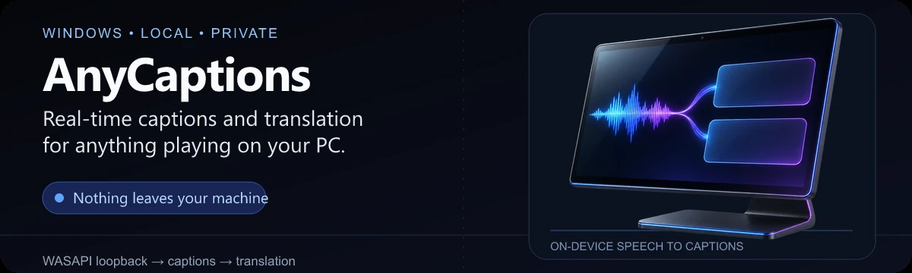
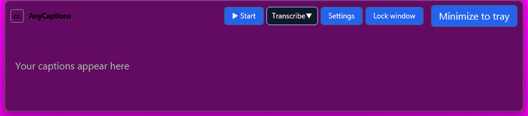
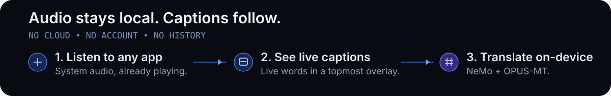

<p align="center">
  
</p>

<p align="center">
  <strong>Real-time captions and translation for anything playing on your PC.</strong><br>
  Fully local speech recognition and translation for Windows — no cloud, no account, no history.
</p>

<p align="center">
  <a href="https://github.com/lukavtz/AnyCaptions/releases/latest"><strong>Download for Windows x64</strong></a> ·
  <a href="#how-it-works">How it works</a> ·
  <a href="#models">Models</a> ·
  <a href="#development">Development</a>
</p>

## Hear it. Read it. Understand it.

AnyCaptions listens to the audio you are already hearing — games, videos, calls, or any other app — and shows a floating caption overlay above everything. Speech recognition and translation run entirely on your machine.



### What you can do

- **Caption any Windows app** through WASAPI loopback. No microphone or virtual cable is required.
- **Translate into 37 languages** with automatic language detection and a fast English ↔ Portuguese path.
- **Keep the overlay out of the way.** Lock it for click-through viewing, then recover it from the tray or `Ctrl+Alt+L`.
- **Label up to 8 speakers** with an optional 107 MB diarization model. Labels describe voices, not identities.
- **Dictate instead of type** with push-to-talk or toggle mode, using your existing caption settings.
- **Download larger models only when needed.** The English ASR, large translation, and diarization models install inside the app with exact size and integrity checks.

## How it works



1. **Listen** to system audio through WASAPI loopback.
2. **Read** streaming words in a topmost GPUI overlay.
3. **Translate** locally with NeMo and OPUS-MT. Audio and captions stay in memory and are never written to disk as history.

## Get started

### Install

1. Download the latest NSIS installer from [**Releases**](https://github.com/lukavtz/AnyCaptions/releases/latest).
2. Run `AnyCaptions_0.2.0_x64-setup.exe` on Windows 11 x64.
3. Start AnyCaptions, choose the output device, and press **Start**.
4. Open **Settings** to change language, colors, caption size, shortcuts, or models.

Updates use a minisign-verified `update.json` manifest and a flat package containing only the executable and runtime DLLs. Models stay installed across updates.

### Build from source

Install **Rust 1.90+ (MSVC, `x86_64-pc-windows-msvc`)** and the Visual Studio C++ build tools with the Windows SDK. Then run:

```powershell
git clone https://github.com/lukavtz/AnyCaptions.git
cd AnyCaptions
cargo run -p anycaptions
```

Models and inference libraries are needed only to transcribe and translate, not to compile.

## Models

| Model | Role | Delivery |
| --- | --- | --- |
| **Nemotron 3.5 ASR Streaming 0.6B** | Multilingual streaming captions with punctuation, endpointing, and language detection | Bundled |
| **Nemotron Speech Streaming EN 0.6B** | Optional English-only profile for an explicit `en-US` or `en-GB` source | On-demand download (699,872,960 bytes) |
| **Riva Translate 4B Instruct v2** | Translation into 37 languages | On-demand download |
| **Nemotron 3 Diarization** | Up to 8 generic speaker labels alongside captions | On-demand download |
| **OPUS-MT en ↔ pt** | Fast English ↔ Portuguese translation on CPU | Bundled |

NeMo-Speech.cpp powers recognition and Riva; CTranslate2 powers OPUS-MT. GPU acceleration uses Vulkan with CPU fallback. Auto and every non-English source keep the multilingual ASR; the English profile is selected only for an explicit `en-US` or `en-GB` source after its verified download. Profile selection happens when a session opens, never mid-stream. The current models are not interchangeable with offline Whisper checkpoints: the default ASR is selected for native streaming, not merely for artifact size.

## Development

The desktop is **Rust + GPUI + Win32**. The workspace is split into `anycaptions-core`, `anycaptions-ui`, `anycaptions-platform-win32`, and the `anycaptions` host.

```powershell
cargo test --workspace --locked
cargo clippy --workspace --all-targets --locked -- -D warnings
cargo audit
powershell -NoProfile -ExecutionPolicy Bypass -File scripts/test-packaging.ps1
powershell -NoProfile -ExecutionPolicy Bypass -File scripts/verify-overlay.ps1
powershell -NoProfile -ExecutionPolicy Bypass -File scripts/verify-accessibility.ps1
```

Real-model integration tests live in `crates/anycaptions-core/tests/` and run explicitly with `--ignored`. Packaging uses `scripts/package-release.ps1` with a local NSIS compiler and a minisign secret key supplied outside the repository.

## Your data

- Audio and captions remain in memory; there is no transcript history.
- Settings stay locally in `%APPDATA%\com.anycaptions.app`.
- Models live in `models/` next to the executable.
- Network access is limited to optional model downloads and updates.

### Licenses and notices

Multilingual Nemotron ASR and Nemotron 3 Diarization: **OpenMDW-1.1**. English Nemotron Speech Streaming and Riva Translate: **NVIDIA Open Model License**. OPUS-MT: **CC-BY-4.0**. Selector flags: **MIT**. See the model cards in `backend/models/README.md` for exact revisions and notices.
